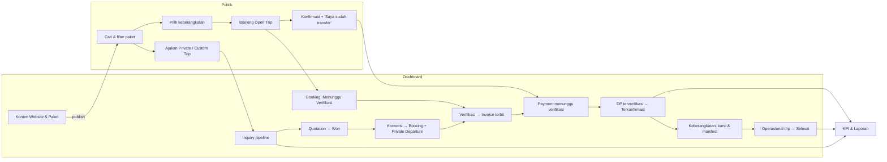

# Arsitektur

## 1. Ringkasan produk

**NusaVista Journey** adalah operator travel Indonesia fiktif yang dipakai Kalsara Digital Studio untuk mendemokan website travel dan sistem operasional dalam satu produk. Pengunjung showcase (calon klien Kalsara) dapat menjelajah sendiri kedua sisi dan melihat bahwa aksi di satu sisi langsung terlihat di sisi lain.

| Sisi | Pengguna dalam cerita | Tujuan |
|---|---|---|
| Website publik | Calon wisatawan | Menemukan destinasi, membandingkan paket, booking Open Trip, mengajukan Private/Custom Trip |
| Dashboard operasional | Owner, Sales, Operasional, Finance, Content | Mengelola inquiry, booking, pembayaran, keberangkatan, operasional trip, HPP, konten, laporan |
| Lapisan demo | Calon klien Kalsara | Panduan perjalanan demo, indikator Demo Mode, reset data, penanda aksi simulasi |

Alur lintas modul yang harus terasa nyata:



## 2. Keputusan yang sudah diambil

| Topik | Keputusan |
|---|---|
| Bahasa | Seluruh UI dan konten dalam Bahasa Indonesia (EYD). Kode dan identifier dalam bahasa Inggris. Istilah industri yang lazim tetap dipakai: Open Trip, Private Trip, booking, invoice, DP, guide. |
| URL | Website publik memakai slug Indonesia (`/paket`, `/destinasi`). Dashboard di bawah `/dashboard/…` dengan segmen Inggris yang sama dengan nama modul. Detail di [route-map.md](route-map.md). |
| Foto | Foto Unsplash untuk tahap awal, diunduh dan dioptimasi ke `public/images` (tidak hotlink), dengan kredit fotografer di katalog media dan halaman kredit foto. Setiap foto diverifikasi menampilkan destinasi yang benar. |
| Persistensi | `localStorage` di balik interface repository ([ADR-0001](adr/0001-browser-local-repository-behind-interfaces.md)). |
| State turunan | Sisa kursi, status pembayaran, KPI dihitung, tidak disimpan ([ADR-0002](adr/0002-derived-state-over-stored-counters.md)). |
| Render | Konten statis dirender server, data hidup di client island ([ADR-0003](adr/0003-render-static-content-then-hydrate-live-data.md)). |
| Jenis trip | Siklus berbeda per jenis trip, bertemu di Departure ([ADR-0004](adr/0004-separate-lifecycles-per-trip-type.md)). |
| Package manager | npm (satu-satunya yang tersedia di mesin pengembangan). |
| Indeks mesin pencari | Seluruh situs `noindex`, karena brand fiktif tidak boleh muncul di hasil pencarian sebagai agen travel sungguhan. |

## 3. Stack dan kebijakan dependency

| Paket | Fungsi | Alasan masuk |
|---|---|---|
| `next`, `react`, `react-dom` | App Router, RSC, `next/image`, `next/font` | Stack yang diminta, kompatibel dengan Vercel |
| `typescript` (strict) | Tipe | Wajib. 5.9.3, sesuai template `create-next-app` 16.4; TypeScript 7 (native) belum dipakai |
| `tailwindcss` v4 | Styling dan token | Token didefinisikan di CSS (`@theme`) |
| `shadcn` (CLI) + Radix | Primitif UI aksesibel (dialog, sheet, popover, select, tabs, dropdown) | Kode komponen disalin ke repo dan dikustomisasi; bukan tampilan default |
| `lucide-react` | Ikon | Diminta |
| `motion` | Animasi halus di website publik | Diminta. Dipakai lewat `LazyMotion` agar bundle kecil |
| `recharts` | Grafik dashboard dan laporan | Diminta |
| `react-hook-form`, `zod`, `@hookform/resolvers` | Form dan validasi | Diminta. Skema Zod dipakai ulang oleh service |
| `zustand` | Store snapshot database dan preferensi UI | Ringan, mendukung selector dan `useSyncExternalStore` |
| `date-fns` | Aritmetika tanggal dan locale `id` | Diminta |
| `react-day-picker` | Kalender pemilih tanggal (komponen Calendar shadcn) | Pemilihan tanggal Private/Custom Trip dan form dashboard |
| `sonner` | Toast | Standar shadcn |
| `@dnd-kit/core` | Drag-and-drop kanban inquiry | Mendukung keyboard dan sentuhan; HTML5 DnD tidak |
| `@react-pdf/renderer` | PDF itinerary yang diunduh dari detail paket | Teks PDF asli (bisa dicari dan disalin), dibuat di browser tanpa server; dimuat dengan dynamic import saat tombol diklik |
| `vitest` (dev) | Unit test aturan domain dan invarian seed | Kebenaran angka keuangan dan kursi wajib teruji |

Tidak dipakai, dengan sengaja: TanStack Table (tabel ≤ 100 baris cukup dengan komponen sendiri), TanStack Query (belum ada server; seam disiapkan di hook), immer, library i18n (satu bahasa), library ID atau zona waktu (WIB = UTC+7 tetap).

Kebijakan versi: versi dikunci persis (tanpa `^`) pada rilis yang sudah berumur minimal 14 hari saat dipasang. `engines.node` diset `>=20.9` mengikuti Next.js; Vercel memakai Node LTS default.

Catatan Phase 1:

- Next.js 16.4.0 dengan **Cache Components** dan **Partial Prefetching** aktif (default template). Tailwind dimuat lewat loader `@tailwindcss/turbopack`, bukan PostCSS.
- `shadcn init` menambahkan paket `cn` (0.x, rilis terbaru 4 hari) dan paket CLI `shadcn` sebagai dependency. Keduanya dihapus: `cn()` memakai `clsx` + `tailwind-merge`, dan bagian `shadcn/tailwind.css` yang dibutuhkan disalin ke `src/app/shadcn-base.css`.
- `npm audit` produksi: 0 kerentanan. Lima temuan `high` hanya di tooling dev (`eslint-config-next` → `braces`).

Catatan Phase 2:

- `motion` 13.5.1 (bukan 14.0.0 yang baru berumur 18 hari dan berganti versi mayor) dan `react-day-picker` 9.14.0 (v9 stabil; v10 baru keluar). Kalender memakai locale `id` dari `date-fns`, Senin sebagai awal minggu.
- `tailwind-merge` diberi tahu skala tipografi kustom (`text-display-*`, `text-heading`, dll.). Tanpa itu, `cn()` menganggapnya warna dan membuangnya saat bertemu `text-ocean-900`.
- `next/image`: prop `priority` sudah deprecated di Next 16 dan diganti `preload`.

Catatan Phase 3:

- Dependency baru: `@dnd-kit/core` 6.3.1 (kanban), `recharts` 3.10.1 (tren booking, dimuat dengan `next/dynamic` agar hanya halaman yang memakainya yang memuat), dan `react-is` 19.3.0 karena Recharts membutuhkan versi yang sama dengan React (yang terpasang sebelumnya hanya v16 dari tooling lint).
- Otorisasi persona ada di service: setiap perintah dashboard menerima `userId` persona dan memanggil `requirePermission()` di dalam transaksi. UI memakai `usePersona()` dan `PermissionButton` hanya untuk menonaktifkan tombol dengan tooltip alasan.
- Perintah dari UI lewat `useCommand()`: status pending, toast sukses/gagal, dan `Result` yang tetap bisa dipetakan ke field form.
- Sheet dan dialog dirender di portal, tetapi event React tetap merambat ke form di luarnya. Form di dalam sheet menghentikan perambatan `submit`, dan `PermissionButton` default `type="button"` agar tidak men-submit form editor secara tidak sengaja.
- Halaman detail dashboard (`[id]`) tidak punya `generateStaticParams`; ID dibaca dengan `useParams()` di dalam `<Suspense>` dan data diambil dari database browser. React 19 juga otomatis mem-preload gambar yang tidak `lazy` saat render server, sehingga galeri memakai satu set elemen untuk semua breakpoint (strip geser di mobile, grid di desktop) agar hanya satu foto yang di-preload.

Catatan Phase 4:

- Service baru: `payment-service` (verifikasi, tolak, catat manual, refund), `operations-service` (checklist dan vendor), `costing-service` (komponen biaya dan biaya aktual). Read model baru di `services/queries/`: `payments`, `invoices`, `operations`, `costing`. Laporan dihitung di `domain/rules/reports.ts`, laba realisasi di `departureRealized()` (`domain/rules/metrics.ts`).
- Layout cetak `app/print` tanpa chrome. Dokumen invoice dan manifest adalah komponen yang sama dengan tampilan dashboard (`InvoiceDocument`, `ManifestTable`), sehingga angka di layar dan di kertas tidak bisa berbeda. Ukuran A4 dan margin dari aturan `@page` di `globals.css`.
- Warna grafik divalidasi dengan validator skill `dataviz` terhadap permukaan kartu `#ffffff`. Warna brand (teal, navy, pasir) gagal ambang chroma 0,10 pada ukuran grafik, jadi data memakai palet referensi yang lolos semua cek (`components/dashboard/charts/chart-theme.ts`): kategori biru/oranye/aqua, ramp ordinal biru untuk funnel, skala status untuk umur tagihan. Elemen kerangka (grid, teks sumbu) tetap memakai token dashboard. Setiap grafik punya ringkasan teks dan tabel alternatif (`ChartFrame`). Grafik tren di Overview yang sebelumnya memakai dua sumbu-Y diubah menjadi satu sumbu.
- `next build` dan `next dev` yang berjalan bersamaan pada direktori yang sama membuat worker dev server crash (modul usang, redirect berulang). Hentikan dev server sebelum build.

Catatan Phase 5:

- Service baru: `content-service` (bagian Site Content, artikel, testimoni), `team-service` (undang, peran, status, izin per peran), `settings-service`. Izin peran bisa diubah kecuali Owner; karena `requirePermission()` membaca peran di dalam setiap transaksi, perubahan langsung berlaku tanpa memuat ulang.
- Panduan demo (`demoJourney()` di `services/demo-service.ts`) dihitung, bukan disimpan sebagai centang: langkah booking, verifikasi, dan pembayaran dibaca dari data; langkah yang tidak meninggalkan jejak (membuka paket, dashboard, keberangkatan, laporan) memakai waktu kunjungan terakhir di `ui-store` (`journeyVisits`). Kunjungan yang lebih tua dari `meta.seededAt` diabaikan, sehingga reset otomatis mengulang panduan. `JourneyTracker` menunggu rehidrasi `ui-store` sebelum mencatat agar tidak tertimpa nilai tersimpan.
- Toggle "Jaringan lambat" dan "Gagalkan penyimpanan berikutnya" (`services/runtime.ts`) kini bisa diamati lewat `useSyncExternalStore`, karena toggle gagal-simpan mati sendiri setelah satu perintah.
- Pemilih satu foto (`PhotoField`) membuka katalog di dialog. Tombolnya punya nama aksesibel sendiri ("Pilih foto sampul artikel"); menautkannya ke label field lewat `id` membuat namanya tertimpa label.
- Next.js menolak dua `next dev` pada direktori yang sama; bila sudah ada dev server lain (misalnya di port 3000), pakai server itu.

Catatan Phase 6:

- `components/ui/return-focus.ts` dipakai `DialogContent` dan `SheetContent`: elemen yang terfokus saat dialog dibuka dicatat di `onOpenAutoFocus` dan diberi fokus lagi di `onCloseAutoFocus`. Tanpa ini, dialog terkontrol (dibuka dari state, tanpa `DialogTrigger`) menjatuhkan fokus ke `<body>`.
- `SelectTrigger` dasar kini `min-w-0` dan memotong nilainya, sehingga nilai panjang tidak melebarkan form di layar sempit. Daftar kartu mobile `DataTable` memakai `grid-cols-1` agar kartu tidak melebar mengikuti teks yang di-*truncate*.
- Grafik recharts memakai `accessibilityLayer={false}`: grafik disembunyikan dari pembaca layar (`aria-hidden`), dan ringkasan teks serta tabel alternatif yang membawa datanya.
- 404 di bawah `/dashboard` lewat `[...missing]/page.tsx` yang memanggil `notFound()`, sehingga `dashboard/not-found.tsx` tampil di dalam shell dashboard.
- QA di build produksi memakai skrip Playwright (di luar repository): sweep overflow 4 lebar layar, axe-core, tab-through keyboard, ke-20 interaksi, dan pengukuran LCP/TBT dengan throttling CPU dan jaringan.

Catatan unduh itinerary (PDF):

- `@react-pdf/renderer` 4.9.0. `ItineraryDownload` mengimpor `features/packages/itinerary-pdf.tsx` secara dinamis saat diklik, sehingga library PDF tidak masuk JavaScript awal halaman. Dokumen dibuat dari paket dan keberangkatan di database browser, jadi paket buatan dashboard dan sisa kursi terbaru ikut tercermin. Foto sampul dipotong dan diperkecil lewat canvas (1400×525 JPEG) agar file tetap ringan.
- Font TTF di `public/fonts/pdf` didaftarkan dari origin halaman. Pemenggalan kata dimatikan (aturan bahasa Inggris memotong kata Indonesia), begitu juga ligatur `fi`/`fl`, karena glyph ligatur hanya dipetakan balik ke "f" sehingga teks yang disalin terbaca "konfrmasi".
- `lineHeight` dipasang di `View` pembungkus, bukan di `Page`: di `Page`, footer nomor halaman (`Text` dengan prop `render`) terlempar ke luar halaman saat layout ulang. Judul "Rencana perjalanan" dikelompokkan dengan hari 1 dalam `View wrap={false}` karena `minPresenceAhead` tidak mencegahnya tertinggal sendirian di bawah halaman.

## 4. Lapisan aplikasi

```text
app/ + components/            UI: halaman, layout, komponen presentasi
        │ hanya memanggil
        ▼
features/*/hooks              useXxx() → { data, status, error } · useXxxAction() → { run, isPending }
        │
        ├──► read models       services/queries/*  — fungsi murni atas snapshot database
        ▼
services/*                    use case: validasi, aturan domain, transaksi, ActivityEvent
        │ bergantung pada interface
        ▼
repositories/interfaces       DataSource + UnitOfWork (repository per agregat dalam satu transaksi)
        ▼
repositories/mock             implementasi localStorage → LocalDatabase → StorageAdapter

domain/                       tipe entitas + aturan murni (kursi, pembayaran, transisi, HPP, KPI)
                              boleh diimpor semua lapisan; tidak mengimpor React, storage, atau Next
```

Aturan import (ditegakkan dengan `no-restricted-imports` di ESLint):

- `app/`, `components/`, dan `features/*/components` tidak boleh mengimpor `repositories/mock`, `data/fixtures` (kecuali halaman server publik melalui `services/catalog-server`), atau memanggil `localStorage`.
- `domain/` tidak boleh mengimpor apa pun di luar `domain/` dan `lib/` yang murni.
- Service mendapatkan repository dari composition root `repositories/index.ts` (`getDataSource()`), bukan dengan mengimpor implementasi mock langsung.

**Seam untuk backend nanti:** hook fitur mengembalikan bentuk `{ data, status, error }` sejak awal, sehingga komponen sudah menangani loading dan error. Saat API tersedia, implementasi hook diganti ke query cache di atas repository API, service berpindah ke server, dan komponen tidak berubah.

## 5. Data layer

### 5.1 Dokumen database

```ts
interface DemoDatabase {
  meta: {
    schemaVersion: number;       // naik saat bentuk data berubah → wajib migrasi
    seedVersion: string;         // naik saat isi seed berubah → tawarkan reset
    seedAnchor: DateOnly;        // tanggal acuan seed
    seededAt: Timestamp;
    counters: Record<string, number>;   // nomor urut kode manusia (booking, invoice, …)
  };
  destinations: Record<ID, Destination>;
  packages: Record<ID, TourPackage>;
  departures: Record<ID, Departure>;
  // … satu Record per entitas di domain-model.md
  siteContent: SiteContent;
  settings: Settings;
}
```

- Key storage: `nusavista-demo:db` (dokumen) dan `nusavista-demo:ui` (preferensi UI per pengunjung).
- Perkiraan ukuran: 300–600 KB, jauh di bawah kuota sekitar 5 MB.
- Jika localStorage tidak tersedia (mode privat, kuota penuh), `MemoryStorageAdapter` dipakai dan banner memberi tahu bahwa perubahan hilang setelah refresh.

### 5.2 Transaksi

```text
service.action(input)                         async, dipanggil hook fitur
  → runCommand(work)                          services/runtime.ts
      1. jeda latensi simulasi (dan kegagalan simulasi bila diaktifkan)
      2. DataSource.transaction((uow) => …)   sinkron
           a. baca dokumen terbaru dari storage (bukan cache tab)
           b. jalankan aturan domain pada salinan kerja (structuredClone)
           c. tulis ke storage; validateDatabase() saat development
      3. publish snapshot baru → db-store → UI render ulang
  → hasil: { ok: true, data } | { ok: false, error: DomainError }
```

Transaksi sengaja sinkron. Unit of work bekerja pada salinan dokumen di memori, sehingga atomik tanpa kunci, dan error di tengah transaksi tidak menulis apa pun. Latensi dan kegagalan simulasi ada di `runCommand`, bukan di repository.

Snapshot yang dipublikasikan selalu objek tingkat atas yang baru (`{ ...draft }`). `getIndexes()` di-memo per objek snapshot, sehingga indeks yang dihitung di dalam transaksi (sebelum mutasi) tidak pernah terbawa ke snapshot hasil commit. Bug ini ditemukan di Phase 2 dan dikunci oleh test.

Service website: `placeWebsiteBooking` (cek kursi terhadap dokumen terbaru di dalam transaksi, sehingga dua tab tidak bisa overbooking), `recordPaymentConfirmation` (payment `pending_verification`, dibatasi sisa tagihan yang belum dikonfirmasi), `placeWebsiteInquiry` (private, custom, general), dan `resolveCustomer` (dedupe telepon lalu email, §6.8 domain model).

`DomainError` memiliki `code` (`SEATS_UNAVAILABLE`, `INVALID_TRANSITION`, `VALIDATION`, `NOT_FOUND`, `PERMISSION_DENIED`, `STORAGE_UNAVAILABLE`, `SIMULATED_FAILURE`) dan `message` bahasa Indonesia yang siap ditampilkan.

### 5.3 Sinkronisasi antartab

Event `storage` dari tab lain memuat ulang snapshot dan menaikkan versinya. Karena setiap transaksi membaca dokumen terbaru sebelum menulis, website dan dashboard di dua tab tetap konsisten tanpa saling menimpa.

### 5.4 Seed, versi, migrasi, reset

- `buildSeed(anchor: DateOnly)` membangun dataset deterministik: skenario yang ditulis tangan ditambah data pengisi dari PRNG ber-seed tetap. Rencana isinya ada di [seed-data.md](seed-data.md).
- Saat load: tidak ada dokumen → seed baru. `schemaVersion` lebih lama → jalankan migrasi berurutan. Dokumen rusak atau versi tidak dikenal → seed baru + toast pemberitahuan.
- `seedVersion` berbeda → banner "Data demo versi baru tersedia" dengan tombol reset.
- Seed Anchor lebih tua dari 14 hari → banner "Tanggal data demo sudah lama" dengan tombol reset.
- Reset (dari dashboard Settings, halaman `/demo`, atau panel demo) menghapus dokumen dan membangun seed dengan anchor hari ini, setelah konfirmasi.

### 5.5 Waktu, ID, dan kode

- `clock.now()` adalah satu-satunya sumber waktu. `today()` dihitung dalam WIB (UTC+7, tanpa DST) sebagai `DateOnly`.
- ID runtime: prefiks + 10 karakter acak dari `crypto.getRandomValues`.
- Kode manusia memakai counter di `meta.counters`: `NV-2610-0143` (booking), `INV/NV/2026/10/0042` (invoice), `PAY-2610-0088`, `INQ-0187`, `QUO-0187-v2`, `CUS-0042`.

### 5.6 System Job

`runSystemJobs(now)` berjalan saat hydration dan setiap 60 detik selama tab terlihat. Job ini idempoten:

1. Membatalkan booking `pending`/`awaiting_payment` dengan hold kedaluwarsa (`hold_expired`).
2. Menyelesaikan booking `confirmed` yang departure-nya sudah berakhir, sudah lunas, dan checklist operasionalnya lengkap (aturan yang sama dengan tombol "Tandai selesai", invarian 13).

Setiap perubahan dicatat sebagai ActivityEvent dengan actor "Sistem".

### 5.7 Latensi dan kegagalan simulasi

- Mutasi diberi jeda 300–700 ms agar state loading dan tombol pending terlihat realistis. Pembacaan tidak diberi jeda.
- Pengaturan Demo di dashboard menyediakan dua toggle: "Jaringan lambat" (jeda 2–3 detik) dan "Gagalkan penyimpanan berikutnya" untuk mendemokan state error dan tombol coba lagi.

## 6. Strategi render

| Area | Server | Client |
|---|---|---|
| Website publik | Layout, hero, editorial, deskripsi destinasi/paket, artikel, metadata halaman (dari fixture seed melalui `services/catalog-server`) | Daftar keberangkatan, sisa kursi, filter/sort, paket buatan dashboard, Site Content yang diedit, semua form |
| Dashboard | Shell layout (sidebar, topbar) | Seluruh data, dengan skeleton saat hydration |
| Cetak invoice | Shell tanpa chrome | Data invoice |

Aturan anti hydration error:

- Jalur render server tidak memanggil `new Date()`, `Math.random()`, `toLocaleString`, atau `Intl`. Format rupiah (`Rp3.450.000`) dan tanggal (`4 Nov 2026`) memakai formatter deterministik di `lib/format`.
- Nilai yang bergantung waktu ("3 hari lagi", "sisa 2 kursi") hanya dirender setelah mount, dengan placeholder berukuran sama agar tidak ada layout shift.
- Island menerima `initialData` dari server dan memakainya pada render pertama, lalu berpindah ke data store setelah store terhidrasi.

Statis vs dinamis: halaman publik untuk slug seed dibangun statis (`generateStaticParams`). Dengan Cache Components, slug di luar daftar itu (paket buatan dashboard) dirender saat request. Opsi `dynamicParams` tidak tersedia dalam mode ini. Client component yang memakai `usePathname`/`useSearchParams` dibungkus `<Suspense>`. Halaman detail dashboard (`[id]`) tidak membutuhkan data di server.

Pola yang dipakai di Phase 2:

- `await params` dilakukan di komponen async di dalam `<Suspense>`, bukan di level halaman, agar navigasi tetap instan (insight "instant navigation" Next 16).
- Island yang membaca query string punya dua varian: `XxxRoute` (memakai `useSearchParams`, di dalam `<Suspense>`) dan `XxxFallback` (tanpa query, dirender di shell statis). Contoh: daftar paket, detail paket (`?keberangkatan=`), alur booking.
- Halaman konfirmasi (`/konfirmasi/*/[code]`) tidak punya `generateStaticParams`; kode dibaca dengan `useParams` di dalam `<Suspense>` karena booking hanya ada di browser pengunjung.
- Waktu sekarang dibaca lewat `useNow()` (`useSyncExternalStore`, `null` saat server render dan hydration, berdetak tiap 30 detik), sehingga sisa kursi, hold, dan tanggal relatif tidak pernah menimbulkan hydration mismatch.
- Katalog awal untuk island dikirim dalam versi ringkas (`getSeedCatalog()` mengosongkan itinerary, FAQ, dan syarat), kecuali paket yang sedang dibuka. Data lengkap datang dari database browser setelah hydration.
- Kotak pencarian yang tersinkron ke URL memakai `useUrlSearchInput`: hasil filter langsung mengikuti ketikan, URL menyusul setelah jeda, dan perubahan URL dari tombol back tetap tercermin.

Lingkup tema: `ThemeScope` memberi class `.theme-public` / `.theme-dashboard` pada subtree. Konten portal (dialog, menu, tooltip) dibungkus `ThemeScopeContents` (elemen `display: contents`), sehingga mewarisi token yang sama meskipun dirender di `<body>`.

## 7. State di client

| Store | Isi | Persistensi |
|---|---|---|
| `db-store` | Snapshot `DemoDatabase`, `version`, `status: 'hydrating' \| 'ready' \| 'unavailable'` | Dikelola LocalDatabase (`nusavista-demo:db`) |
| `ui-store` | Sidebar terlipat, persona aktif, progres panduan demo yang ditutup, view terakhir (tabel/kanban/kalender) | `nusavista-demo:ui`, dibungkus try/catch |

Selector turunan (sisa kursi, status pembayaran, KPI) di-memo per `version` snapshot.

## 8. Form dan validasi

- Skema Zod per form ada di `features/*/schemas`. Pesan error dalam bahasa Indonesia.
- Service memvalidasi ulang dengan aturan domain, karena aturan yang bergantung data (sisa kursi, transisi status) tidak bisa dijamin oleh form. Error dari service dipetakan ke field atau ke banner form.
- Form publik menampilkan catatan "Gunakan data fiktif. Data hanya tersimpan di browser ini." dan tidak meminta nomor identitas, data kesehatan, atau data pembayaran.

## 9. Lapisan demo

- **Dashboard:** badge **Demo Mode** di topbar membuka panel berisi: panduan perjalanan demo, buka website publik, reset data, dan tanggal Seed Anchor.
- **Website publik:** tombol kecil "Demo" di pojok kiri bawah dengan isi panel yang sama, ditambah tautan ke dashboard. Footer mencantumkan "Situs demonstrasi · Dikembangkan oleh Kalsara Digital Studio".
- **Halaman `/demo`:** pintu masuk showcase: penjelasan singkat, dua tombol utama (Website / Dashboard), langkah perjalanan demo, dan reset.
- **Panduan perjalanan demo:** 7 langkah dari requirement §10. Langkah dicentang otomatis dengan membaca data (misalnya langkah "Buat booking" selesai jika ada booking dari website yang dibuat setelah seed), sehingga progres tidak bisa berbeda dari kenyataan.
- **Aksi simulasi** selalu diberi label: tombol WhatsApp membuka dialog "Simulasi — pesan tidak dikirim" alih-alih tautan `wa.me`; email dan bukti transfer bertanda simulasi; halaman konfirmasi tidak pernah memakai kata "pembayaran berhasil" untuk transaksi nyata.

## 10. State UI yang wajib ada

Setiap halaman data memiliki empat state yang dirancang: **loading** (skeleton sesuai layout), **kosong** (penjelasan + aksi utama), **error** (pesan + coba lagi), dan **sukses** (toast atau perubahan inline). Error boundary per segmen route (`error.tsx`) dan `not-found.tsx` khusus untuk publik dan dashboard.

## 11. Aksesibilitas dan performa

- HTML semantik, label pada semua input, focus ring terlihat (token `--ring`), skip link, urutan heading benar.
- Dialog dan sheet memakai Radix (focus trap, `Esc`, kembali fokus). Kanban memiliki alternatif keyboard ("Pindahkan ke…") selain drag.
- Grafik memiliki ringkasan teks dan tabel data alternatif.
- `prefers-reduced-motion` mematikan animasi non-esensial.
- Target: LCP website publik < 2,5 dtk di 4G, hero memakai `next/image` dengan `priority` dan `sizes` yang benar; gambar lain lazy load; JavaScript publik minimal (Motion dan Recharts tidak dimuat di halaman yang tidak memakainya).

## 12. Deployment

- Vercel, preset Next.js, tanpa environment variable. `next build` harus lolos type-check dan lint.
- Semua data berada di browser, sehingga setiap pengunjung mendapat salinan demo sendiri. Tidak ada state server yang perlu dibersihkan.
- `noindex, nofollow` lewat metadata `robots` dan header `X-Robots-Tag` di semua respons (termasuk gambar dan font). `robots.txt` sengaja mengizinkan crawl: `noindex` hanya terbaca di halaman yang boleh diambil crawler, sedangkan URL yang diblokir `robots.txt` tetap bisa terindeks bila ditautkan dari situs lain.
- Domain demo `nusavista-journey.demo.kalsara.id`; `nusavista-journey.vercel.app` dialihkan ke sana (308) lewat `redirects()` di `next.config.ts`.
