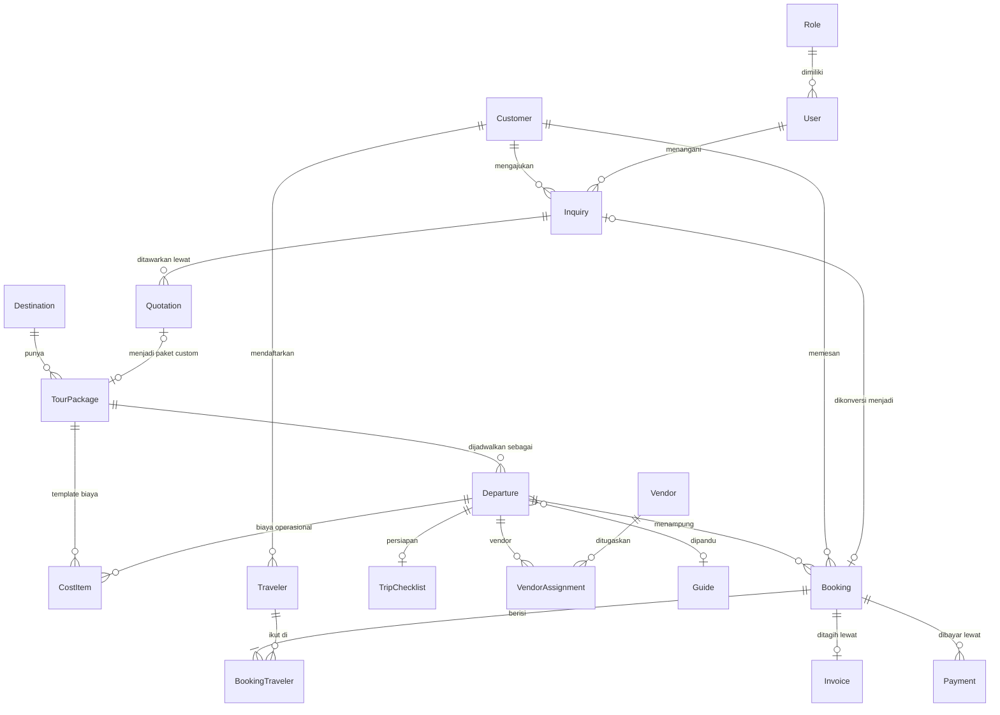
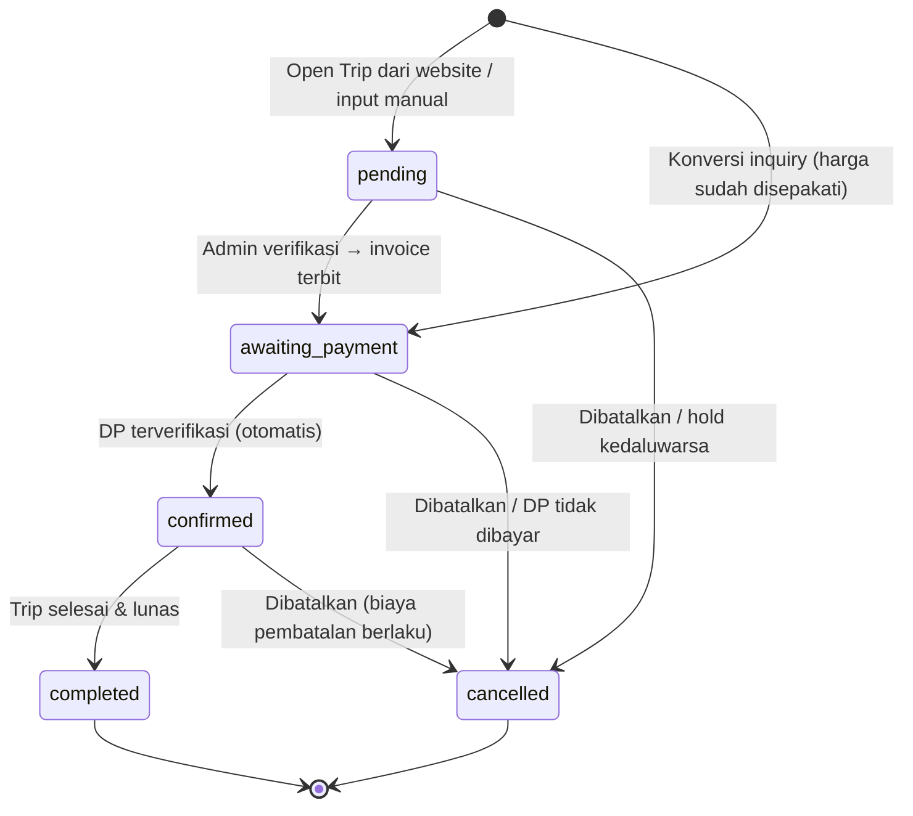
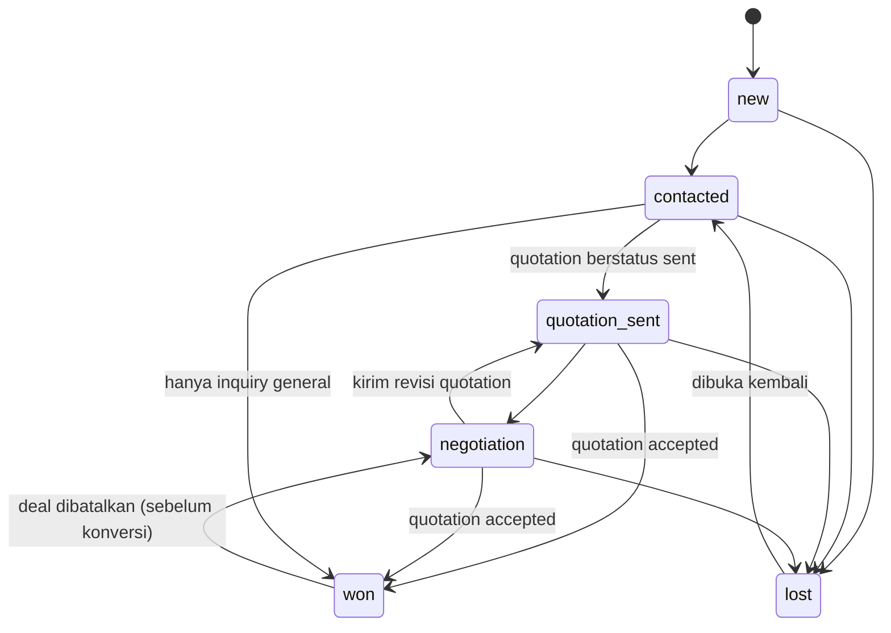

# Domain Model

Dokumen ini adalah kontrak data untuk seluruh showcase. Website publik dan dashboard membaca dan menulis entitas yang sama. Istilah mengikuti [CONTEXT.md](../CONTEXT.md).

## 1. Prinsip pemodelan

| Prinsip | Aturan |
|---|---|
| ID stabil | `id` berprefiks per entitas (`dst_`, `pkg_`, `dep_`, `bk_`, `cus_`, …). ID seed bersifat deterministik (`pkg_lbj_sailing_3h2m`), ID runtime dibuat acak. Kode yang dibaca manusia (`NV-2610-0143`) terpisah dari `id`. |
| Uang | `IDR` = bilangan bulat rupiah. Tidak pernah pecahan. Persentase disimpan sebagai angka 0–100. |
| Tanggal | `DateOnly` (`"2026-11-04"`) untuk tanggal kalender: keberangkatan, jatuh tempo, tanggal lahir. `Timestamp` (ISO UTC) untuk kejadian. Ditampilkan dalam WIB. |
| Turunan, bukan simpanan | Sisa kursi, status pembayaran, sisa tagihan, status keberangkatan, kesiapan trip, dan semua KPI **dihitung** dari data sumber. Tidak ada angka yang bisa "tidak sinkron". Lihat [ADR-0002](adr/0002-derived-state-over-stored-counters.md). |
| Snapshot harga | Booking, quotation, dan invoice menyimpan salinan baris harga. Mengubah harga paket tidak mengubah booking lama. |
| Riwayat terpusat | Semua mutasi penting menulis `ActivityEvent`. Timeline booking, riwayat tahap inquiry, dan feed aktivitas dashboard adalah filter atas log yang sama. |
| Siklus berbeda per jenis trip | Open Trip langsung booking. Private dan Custom melalui Inquiry → Quotation → Booking. Lihat [ADR-0004](adr/0004-separate-lifecycles-per-trip-type.md). |

## 2. Relasi



Kardinalitas penting dari requirement:

- Satu destinasi memiliki banyak paket. Satu paket memiliki banyak departure.
- Satu departure menampung banyak booking dan banyak cost item.
- Satu booking berisi banyak traveler dan banyak payment. Satu customer memiliki banyak booking.
- Private Departure selalu berisi **tepat satu** booking.

## 3. Value object & enum

```ts
type ID = string;
type IDR = number;        // integer rupiah
type DateOnly = string;   // "YYYY-MM-DD"
type Timestamp = string;  // ISO 8601 UTC

type TripType = 'open' | 'private' | 'custom';
type RegionKey = 'bali-nusa-tenggara' | 'jawa' | 'sumatra-kepulauan' | 'papua-maluku';
type DestinationCategory = 'bahari' | 'pulau' | 'pegunungan' | 'budaya' | 'petualangan' | 'santai';
type Source = 'website' | 'whatsapp' | 'instagram' | 'tiktok' | 'referral' | 'google_ads' | 'repeat' | 'walk_in';
type Interest = 'snorkeling' | 'diving' | 'hiking' | 'budaya' | 'kuliner' | 'fotografi' | 'santai' | 'honeymoon' | 'keluarga' | 'petualangan';
type BudgetRange = 'lt_3jt' | '3_5jt' | '5_10jt' | '10_20jt' | 'gt_20jt';   // per orang

type Actor =
  | { kind: 'user'; userId: ID }
  | { kind: 'customer'; customerId: ID }
  | { kind: 'system' };

interface PriceLine { id: ID; label: string; quantity: number; unitPrice: IDR }
interface Note { id: ID; body: string; authorId: ID; createdAt: Timestamp }
interface Faq { question: string; answer: string }

interface EntityMeta { id: ID; createdAt: Timestamp; updatedAt: Timestamp }
```

## 4. Entitas

### 4.1 Katalog

```ts
interface Destination extends EntityMeta {
  slug: string;
  name: string;                       // "Labuan Bajo"
  region: RegionKey;
  province: string;                   // "Nusa Tenggara Timur"
  categories: DestinationCategory[];
  tagline: string;
  summary: string;                    // ≤ 180 karakter, untuk kartu
  description: string[];              // paragraf
  highlights: string[];
  bestTime: string;                   // "April – November"
  gettingThere: string;
  coverMediaId: ID;
  galleryMediaIds: ID[];
  status: 'draft' | 'published';
}

interface TourPackage extends EntityMeta {
  slug: string;
  code: string;                       // "NV-LBJ-OT01"
  title: string;
  tripType: TripType;
  visibility: 'catalog' | 'unlisted'; // custom selalu 'unlisted'
  status: 'draft' | 'published' | 'archived';
  publishedAt?: Timestamp;
  destinationId: ID;
  durationDays: number;
  durationNights: number;
  summary: string;
  overview: string[];
  highlights: string[];
  itinerary: ItineraryDay[];
  inclusions: string[];
  exclusions: string[];
  meetingPoint: { name: string; address: string; time?: string; notes?: string };
  requirements: { minAge?: number; fitness: 'ringan' | 'sedang' | 'menantang'; notes: string[] };
  terms: string[];
  cancellationPolicy: CancellationTier[];      // urut minDaysBefore menurun
  paymentTerms: { depositPercent: number; balanceDueDaysBefore: number };
  pricing: PackagePricing;
  groupSize: { min: number; max: number };
  faqs: Faq[];
  coverMediaId: ID;
  galleryMediaIds: ID[];
  tags: string[];
  isCustomizable: boolean;            // boleh dijadikan dasar Custom Trip
  sourceQuotationId?: ID;             // hanya paket custom
}

type PackagePricing =
  | { kind: 'per_pax'; pricePerPax: IDR }                                        // open
  | { kind: 'tiered'; tiers: { minPax: number; maxPax: number; pricePerPax: IDR }[] } // private
  | { kind: 'quoted' };                                                          // custom: harga di quotation

interface CancellationTier { minDaysBefore: number; feePercent: number }

interface ItineraryDay {
  id: ID;
  day: number;
  title: string;
  description: string;
  activities: string[];
  meals: { breakfast: boolean; lunch: boolean; dinner: boolean };
  accommodation?: string;
}
```

`MediaAsset` adalah katalog statis (bukan bagian data yang bisa diubah). Form paket memilih gambar dari katalog ini dan tidak pernah mengunggah file ke localStorage.

```ts
interface MediaAsset {
  id: ID;
  src: string;                        // "/images/labuan-bajo/padar-sunrise.jpg"
  width: number; height: number;
  alt: string;                        // bahasa Indonesia, deskriptif
  blurDataURL: string;
  credit: { photographer: string; sourceUrl: string };
  tags: string[];                     // slug destinasi, tema
}
```

### 4.2 Keberangkatan & operasional

```ts
interface Departure extends EntityMeta {
  code: string;                       // "LBJ-OT01-261104"
  packageId: ID;
  kind: 'scheduled' | 'private';
  startDate: DateOnly;
  endDate: DateOnly;                  // start + durationDays − 1
  capacity: number;
  minParticipants: number;            // private: 1
  pricePerPaxOverride?: IDR;          // harga musiman untuk open trip
  salesClosed: boolean;
  salesClosedReason?: string;         // ditampilkan di website & dashboard
  cancelledAt?: Timestamp;
  cancellationReason?: string;
  guideId?: ID;
  notes?: string;
}

interface Guide extends EntityMeta {
  name: string;
  phone: string;
  languages: string[];                // ["Indonesia", "Inggris"]
  destinationIds: ID[];               // wilayah kerja
  status: 'active' | 'inactive';
}

type VendorCategory = 'transportasi' | 'kapal' | 'akomodasi' | 'restoran' | 'aktivitas' | 'tiket' | 'dokumentasi';

interface Vendor extends EntityMeta {
  name: string;
  category: VendorCategory;
  destinationIds: ID[];
  contactName: string;
  phone: string;
  notes?: string;
}

interface VendorAssignment extends EntityMeta {
  departureId: ID;
  vendorId: ID;
  service: VendorCategory;
  status: 'requested' | 'confirmed' | 'cancelled';
  note?: string;
}

type ChecklistKey =
  | 'transport' | 'accommodation' | 'traveler_data' | 'itinerary'
  | 'guide' | 'manifest' | 'briefing' | 'equipment';

interface TripChecklist extends EntityMeta {
  departureId: ID;
  items: { key: ChecklistKey; label: string; done: boolean; doneAt?: Timestamp; doneBy?: ID; note?: string }[];
}

type CostCategory =
  | 'transport' | 'accommodation' | 'meals' | 'guide'
  | 'tickets' | 'activities' | 'documentation' | 'other';

interface CostItem extends EntityMeta {
  owner: { type: 'package'; packageId: ID } | { type: 'departure'; departureId: ID };
  category: CostCategory;
  label: string;                      // "Sewa kapal phinisi 2 malam"
  basis: 'fixed' | 'per_pax';
  unitCost: IDR;
  quantity: number;
  vendorId?: ID;
  actualAmount?: IDR;                 // total aktual, diisi setelah trip berjalan
}
```

Cost item milik paket adalah **template**. Saat departure dibuat, template disalin menjadi cost item milik departure yang bisa diubah tanpa memengaruhi paket.

### 4.3 Penjualan

```ts
interface Customer extends EntityMeta {
  code: string;                       // "CUS-0042"
  fullName: string;
  phone: string;                      // E.164 ternormalisasi, "+6281100000123"
  email?: string;                     // lowercase, domain contoh (lihat seed-data.md)
  city?: string;
  preferredContact: 'whatsapp' | 'email' | 'telepon';
  acquisitionSource: Source;
  tags: string[];
  notes: Note[];
}

interface Traveler extends EntityMeta {
  customerId: ID;                     // customer yang mendaftarkan
  isCustomerSelf: boolean;
  fullName?: string;                  // kosong = belum dilengkapi
  gender?: 'L' | 'P';
  dateOfBirth?: DateOnly;
  phone?: string;
  emergencyContact?: { name: string; phone: string };
  dietaryNotes?: string;
}

interface BookingTraveler { id: ID; bookingId: ID; travelerId: ID; isLead: boolean }

type BookingStatus = 'pending' | 'awaiting_payment' | 'confirmed' | 'completed' | 'cancelled';
type CancellationReason = 'customer_request' | 'hold_expired' | 'departure_cancelled' | 'other';

interface Booking extends EntityMeta {
  code: string;                       // "NV-2610-0143"
  customerId: ID;
  packageId: ID;
  departureId: ID;
  tripType: TripType;                 // snapshot
  source: Source;
  inquiryId?: ID;
  quotationId?: ID;
  status: BookingStatus;
  lines: PriceLine[];                 // snapshot harga
  discount: IDR;
  holdExpiresAt?: Timestamp;          // hanya untuk pending & awaiting_payment
  holdExtensions?: number;            // maks. 2 (§5.1)
  specialRequests?: string;
  confirmedAt?: Timestamp;
  completedAt?: Timestamp;
  cancellation?: {
    at: Timestamp; by: Actor; reason: CancellationReason; note?: string;
    feeAmount: IDR; refundAmount: IDR;
  };
}

type PipelineStage = 'new' | 'contacted' | 'quotation_sent' | 'negotiation' | 'won' | 'lost';
type LostReason = 'harga' | 'tanggal_tidak_cocok' | 'pilih_kompetitor' | 'tidak_ada_respons' | 'rencana_batal';

interface Inquiry extends EntityMeta {
  code: string;                       // "INQ-0187"
  type: 'private' | 'custom' | 'general';
  customerId: ID;                     // ditautkan saat submit (dedupe)
  contactSnapshot: { fullName: string; phone: string; email?: string };
  source: Source;
  packageId?: ID;                     // private & general
  destinationIds: ID[];               // custom
  travelDates:
    | { kind: 'exact'; startDate: DateOnly }
    | { kind: 'range'; from: DateOnly; to: DateOnly }
    | { kind: 'flexible'; month?: string };   // "2027-02"
  durationDays?: number;
  groupSize: number;
  budgetPerPax?: BudgetRange;
  interests: Interest[];
  message?: string;
  stage: PipelineStage;
  lostReason?: LostReason;
  assigneeId?: ID;
  nextFollowUpDate?: DateOnly;
  followUps: { id: ID; channel: 'whatsapp' | 'telepon' | 'email' | 'meeting'; body: string; authorId: ID; at: Timestamp }[];
  convertedBookingId?: ID;
}

interface Quotation extends EntityMeta {
  code: string;                       // "QUO-0187-v2"
  inquiryId: ID;
  version: number;
  title: string;
  packageId?: ID;                     // private
  proposedStartDate: DateOnly;
  durationDays: number;
  groupSize: number;
  lines: PriceLine[];
  discount: IDR;
  itinerarySummary: string[];         // satu baris per hari, wajib untuk custom
  validUntil: DateOnly;
  status: 'draft' | 'sent' | 'accepted' | 'rejected';  // 'expired' diturunkan
  sentAt?: Timestamp;
  respondedAt?: Timestamp;
}
```

### 4.4 Keuangan

```ts
interface Invoice extends EntityMeta {
  number: string;                     // "INV/NV/2026/10/0042"
  bookingId: ID;
  issuedAt: Timestamp;
  lines: PriceLine[];                 // identik dengan booking saat terbit
  discount: IDR;
  installments: Installment[];
  voidedAt?: Timestamp;               // booking dibatalkan
  notes?: string;
}

interface Installment {
  id: ID;
  kind: 'deposit' | 'balance' | 'full';
  label: string;                      // "DP 30%", "Pelunasan", "Pembayaran penuh"
  amount: IDR;
  dueDate: DateOnly;
}

interface Payment extends EntityMeta {
  code: string;                       // "PAY-2610-0088"
  bookingId: ID;
  invoiceId?: ID;
  direction: 'in' | 'refund';
  amount: IDR;                        // selalu positif
  method: 'transfer_bank' | 'virtual_account' | 'qris' | 'kartu_kredit' | 'tunai';
  status: 'pending_verification' | 'verified' | 'rejected';
  paidAt: Timestamp;
  reference?: string;
  proofMediaId?: ID;                  // "proof-transfer-illustration": ilustrasi bertanda CONTOH, bukan file asli
  submittedBy: Actor;
  verifiedAt?: Timestamp;
  verifiedBy?: ID;
  rejectionReason?: string;
  note?: string;
}
```

### 4.5 Konten, tim, dan sistem

```ts
interface SiteContent {                // singleton
  hero: { eyebrow: string; title: string; subtitle: string; mediaId: ID; ctaLabel: string };
  promoBanner: { enabled: boolean; message: string; linkLabel?: string; linkHref?: string };
  featuredPackageIds: ID[];           // urutan tampil, maks 6
  featuredDestinationIds: ID[];       // destination highlights, maks 5
  whyUs: { icon: string; title: string; body: string }[];
  homepageFaqs: Faq[];
  about: { headline: string; intro: string; story: string[]; values: { title: string; body: string }[]; mediaIds: ID[] };
  contact: { address: string; email: string; whatsappDisplay: string; officeHours: string };
  updatedAt: Timestamp;
  updatedBy?: ID;
}

interface Article extends EntityMeta {
  slug: string;
  title: string;
  excerpt: string;
  category: 'panduan' | 'inspirasi' | 'tips';
  destinationId?: ID;
  coverMediaId: ID;
  body: ArticleBlock[];
  authorName: string;
  status: 'draft' | 'published';
  publishedAt?: Timestamp;
}

type ArticleBlock =
  | { type: 'paragraph'; text: string }
  | { type: 'heading'; text: string }
  | { type: 'list'; items: string[] }
  | { type: 'quote'; text: string }
  | { type: 'image'; mediaId: ID; caption?: string };

interface Testimonial extends EntityMeta {
  authorName: string;                 // "Dinda, Bandung" — fiktif
  quote: string;
  packageId?: ID;
  tripMonth?: string;                 // "2026-08"
  status: 'published' | 'hidden';
}

type Permission =
  | 'inquiries.manage' | 'bookings.manage' | 'bookings.cancel'
  | 'payments.record' | 'payments.verify'
  | 'packages.manage' | 'packages.publish' | 'departures.manage'
  | 'operations.manage' | 'costing.manage'
  | 'content.manage' | 'reports.view' | 'team.manage' | 'settings.manage';

interface Role { id: ID; key: 'owner' | 'sales' | 'operations' | 'finance' | 'content'; name: string; description: string; permissions: Permission[] }

interface User extends EntityMeta {
  name: string;
  email: string;                      // @nusavista.example
  title: string;                      // "Sales Executive"
  roleId: ID;
  status: 'active' | 'invited' | 'inactive';
}

interface ActivityEvent {
  id: ID;
  at: Timestamp;
  actor: Actor;
  subject: { type: EntityType; id: ID };
  related: { type: EntityType; id: ID }[];
  action: string;                     // "booking.created", "inquiry.stage_changed", ...
  message: string;                    // kalimat siap tampil, bahasa Indonesia
  data?: Record<string, string | number | boolean | null>;
}

interface Settings {                   // singleton
  company: { name: string; tagline: string; address: string; email: string; phoneDisplay: string };
  booking: { pendingHoldHours: number; depositHoldHours: number; salesCutoffDays: number; lowSeatThreshold: number; maxPaxPerBooking: number };
  payment: { defaultDepositPercent: number; defaultBalanceDueDaysBefore: number; bankAccountDisplay: { bank: string; number: string; holder: string } };
  invoice: { prefix: string; footerNote: string };
}
```

Nilai default `Settings`: hold pending 24 jam, hold DP 48 jam, penjualan ditutup bila keberangkatan kurang dari 2 hari lagi (`salesCutoffDays = 2`), sisa kursi "terbatas" bila ≤ 3, maksimal 10 pax per booking, DP 30%, pelunasan H-14. Rekening yang ditampilkan memakai bank dan nomor fiktif yang jelas bertanda simulasi (lihat [seed-data.md](seed-data.md#keamanan-data-fiktif)).

## 5. Siklus hidup

### 5.1 Booking



| Status | Label UI | Kursi | Invoice | Masuk akal bila… |
|---|---|---|---|---|
| `pending` | Menunggu Verifikasi | ditahan s.d. `holdExpiresAt` (24 jam) | belum ada | belum ada payment terverifikasi |
| `awaiting_payment` | Menunggu Pembayaran | ditahan s.d. `holdExpiresAt` (48 jam setelah invoice terbit) | terbit | payment bersih < DP |
| `confirmed` | Terkonfirmasi | dialokasikan | terbit | payment bersih ≥ DP |
| `completed` | Selesai | dialokasikan | terbit | departure sudah berakhir dan lunas |
| `cancelled` | Dibatalkan | dilepas | void | — |

Aturan transisi:

- Status hanya berubah melalui aksi bernama (`approve`, `cancel`, `complete`, `extendHold`) atau efek otomatis dari payment dan System Job. Tidak ada dropdown status bebas.
- `awaiting_payment → confirmed` terjadi otomatis saat payment terverifikasi membuat payment bersih ≥ nominal termin pertama.
- `confirmed → completed` hanya jika `today > departure.endDate` dan status pembayaran `paid`. System Job menyelesaikan booking yang memenuhi syarat. Booking yang belum lunas tetap `confirmed` dan muncul di daftar tagihan.
- `extendHold` menambah 24 jam, maksimal 2 kali per booking, dan tetap tunduk pada sisa kursi.

### 5.2 Inquiry



- Memindahkan kartu ke **Quotation Sent** tanpa quotation membuka pembuat quotation. Tahap baru tersimpan setelah quotation dikirim.
- **Won** untuk private/custom mensyaratkan quotation `accepted`. Quotation lain di inquiry yang sama otomatis `rejected`.
- **Lost** mewajibkan `lostReason`.
- Mencatat follow-up pertama di inquiry `new` memindahkannya ke `contacted`.
- Inquiry yang sudah dikonversi terkunci dan tidak dapat berpindah tahap.

### 5.3 Quotation

`draft → sent → accepted | rejected`. Status **Kedaluwarsa** diturunkan saat `validUntil < today` dan status masih `sent`. Revisi membuat quotation baru dengan `version + 1`. Versi lama tetap tersimpan.

### 5.4 Payment

`pending_verification → verified | rejected`. Hanya `verified` yang dihitung. Payment dari website ("Saya sudah transfer") masuk sebagai `pending_verification`. Payment yang dicatat manual oleh tim finance dapat langsung `verified` jika persona memiliki izin `payments.verify`.

### 5.5 Paket

`draft → published → archived` (dan `archived → draft`). Hanya paket `published` + `catalog` yang tampil di website publik. Syarat publish: minimal satu hari itinerary, cover image, harga valid, dan destinasi `published`. Mengarsipkan paket tidak membatalkan departure yang sudah ada, tetapi menutup penjualannya.

## 6. Aturan bisnis

### 6.1 Kursi dan hold

```text
pax(b)            = jumlah BookingTraveler milik booking b
activeHold(b,now) = b.status ∈ {pending, awaiting_payment} ∧ b.holdExpiresAt > now
allocated(d)      = Σ pax(b) untuk b ∈ d, b.status ∈ {confirmed, completed}
held(d,now)       = Σ pax(b) untuk b ∈ d, activeHold(b,now)
available(d,now)  = max(0, d.capacity − allocated(d) − held(d,now))
occupancy(d)      = allocated(d) / d.capacity
guaranteed(d)     = allocated(d) ≥ d.minParticipants
```

- Kursi publik yang ditampilkan adalah `available`, sehingga hold ikut mengurangi kuota dan overbooking tidak mungkin terjadi.
- Hold yang kedaluwarsa langsung tidak dihitung, meskipun System Job belum berjalan. System Job kemudian membatalkan booking tersebut dengan alasan `hold_expired` dan mencatat aktivitas oleh "Sistem".
- Membuat booking, memperpanjang hold, dan mengonversi inquiry ke Scheduled Departure memeriksa `pax ≤ available` dalam satu transaksi.
- Kapasitas baru harus ≥ `allocated + held`. Form menampilkan batas bawah ini.
- Kapasitas Private Departure selalu sama dengan pax booking-nya dan tidak diedit langsung.

### 6.2 Status keberangkatan (tampilan)

Dievaluasi berurutan, aturan pertama yang cocok menang:

| Kondisi | Status | Label |
|---|---|---|
| `cancelledAt` terisi | `cancelled` | Dibatalkan |
| `today > endDate` | `completed` | Selesai |
| `today ≥ startDate` | `departed` | Berlangsung |
| `available = 0` | `full` | Penuh |
| `salesClosed` ∨ hari menuju berangkat < `salesCutoffDays` ∨ paket diarsipkan | `closed` | Penjualan ditutup |
| `available ≤ lowSeatThreshold` | `limited` | Sisa *n* kursi |
| lainnya | `open` | Tersedia |

Badge tambahan **Pasti Berangkat** muncul jika `guaranteed(d)` dan statusnya `open`, `limited`, atau `full`.

### 6.3 Pembuatan booking Open Trip

1. Validasi departure: `scheduled`, tidak dibatalkan, status `open` atau `limited`, dan `1 ≤ pax ≤ min(available, maxPaxPerBooking)`.
2. Temukan atau buat customer (§6.8).
3. Buat traveler sebanyak pax. Data yang belum diisi boleh kosong; traveler kosong dihitung sebagai "data peserta belum lengkap".
4. Buat booking `pending`, `holdExpiresAt = now + pendingHoldHours`, `lines = [{ label: "<judul paket> · <tanggal>", quantity: pax, unitPrice: harga departure }]`.
5. Tulis ActivityEvent `booking.created` dengan actor `customer`.

Harga departure = `pricePerPaxOverride ?? package.pricing.pricePerPax`.

### 6.4 Invoice dan jadwal termin

Invoice terbit saat booking masuk `awaiting_payment`.

```text
total            = Σ (quantity × unitPrice) − discount
daysToDeparture  = selisih hari kalender (startDate − today)
dueDeposit       = tanggal dari holdExpiresAt

jika depositPercent = 100 ∨ daysToDeparture ≤ balanceDueDaysBefore:
    installments = [ full: total, jatuh tempo dueDeposit ]
selain itu:
    deposit      = ceil(total × depositPercent / 100 / 1000) × 1000   // dibulatkan ke atas per Rp1.000
    balance      = total − deposit
    installments = [ deposit: deposit, jatuh tempo dueDeposit,
                     balance: balance, jatuh tempo startDate − balanceDueDaysBefore ]
```

Jumlah termin selalu tepat sama dengan total. Setelah invoice terbit, baris harga booking terkunci.

### 6.5 Status pembayaran (turunan)

```text
paidNet     = Σ payment verified 'in' − Σ payment verified 'refund'
outstanding = booking.status = cancelled ? 0 : max(0, total − paidNet)
overdue     = ∃ termin i: i.dueDate < today ∧ paidNet < Σ amount termin s.d. i
```

Untuk booking yang tidak dibatalkan:

| Kondisi (berurutan) | Status | Label |
|---|---|---|
| belum ada invoice | `unpaid` | Belum ditagih |
| `paidNet ≥ total` | `paid` | Lunas |
| `overdue` | `overdue` | Lewat jatuh tempo |
| `paidNet > 0` | `partially_paid` | Dibayar sebagian |
| lainnya | `unpaid` | Belum dibayar |

Untuk booking yang dibatalkan: `refundAmount = 0` → `closed` (Tanpa refund); refund terverifikasi < `refundAmount` → `refund_pending` (Refund diproses); lainnya → `refunded` (Refund selesai).

Flag terpisah `hasPendingVerification` menandai booking yang punya payment `pending_verification`.

Validasi pencatatan payment:

- Payment masuk hanya untuk booking `awaiting_payment` atau `confirmed`.
- Nominal tidak boleh melebihi `outstanding`.
- Refund hanya untuk booking `cancelled` dan tidak boleh melebihi sisa refund.

### 6.6 Pembatalan dan refund

```text
daysBefore = selisih hari kalender (departure.startDate − today)
tier       = tier pertama di cancellationPolicy dengan daysBefore ≥ minDaysBefore

jika status ∈ {pending, awaiting_payment} ∨ reason = departure_cancelled:
    fee = 0
selain itu:
    fee = round(total × tier.feePercent / 100)

refund = max(0, paidNet − fee)
```

Kebijakan default: ≥ 30 hari 25%; 15–29 hari 50%; 7–14 hari 75%; < 7 hari 100%. Dialog pembatalan menampilkan tier yang berlaku, biaya, dan refund **sebelum** dikonfirmasi. Invoice di-void, kursi langsung dilepas, dan ActivityEvent mencatat angka-angkanya.

Membatalkan Scheduled Departure membatalkan semua booking aktif di dalamnya dengan `reason = departure_cancelled`.

Sebaliknya, membatalkan booking di Private Departure (termasuk karena hold kedaluwarsa) ikut membatalkan departure tersebut, karena Private Departure hanya ada untuk satu booking itu (`services/departure-cascade.ts`).

### 6.7 Konversi inquiry ke booking

Syarat: tahap `won` dan belum pernah dikonversi.

| Jenis inquiry | Departure | Paket | Status booking awal |
|---|---|---|---|
| `private` | Private Departure baru (capacity = groupSize, tanggal dari quotation) | paket private yang ditanyakan | `awaiting_payment` + invoice |
| `custom` | Private Departure baru | paket `custom` baru (`unlisted`) dari quotation | `awaiting_payment` + invoice |
| `general` | Scheduled Departure yang dipilih admin (cek `available`) | paket departure tersebut | `awaiting_payment` + invoice |

Mencatat penawaran sebagai **disetujui** otomatis memindahkan inquiry ke tahap Berhasil dan menandai versi lain yang masih terbuka sebagai ditolak. Paket custom yang dibuat saat konversi memakai kode `NV-CUS-nnnn`, status terbit, dan visibilitas `unlisted`.

Baris harga booking diambil dari quotation yang disetujui, atau dari harga departure untuk `general`. Booking menyimpan `inquiryId` dan `quotationId`, inquiry menyimpan `convertedBookingId`, dan customer yang dipakai adalah `inquiry.customerId`. Konversi tidak pernah membuat customer baru.

### 6.8 Identitas customer (dedupe)

```text
normalizePhone: buang non-digit → "0…" jadi "62…" → "8…" jadi "628…" → awali "+"
normalizeEmail: trim + lowercase
```

Saat inquiry atau booking dikirim: cari customer dengan phone ternormalisasi yang sama, lalu email. Jika ditemukan, pakai customer tersebut dan isi field yang masih kosong tanpa menimpa nama. Jika nama berbeda, tambahkan catatan sistem. Jika tidak ditemukan, buat customer baru. Phone dan email unik di seluruh data.

Tahap customer diturunkan: **Prospek** (hanya inquiry), **Pelanggan** (≥ 1 booking tidak dibatalkan), **Repeat** (≥ 2 booking selesai).

### 6.9 Operasional trip

Checklist dibuat saat departure dibuat. Item `accommodation` dihilangkan untuk trip 1 hari.

| Item | Label | Bisa dicentang jika… |
|---|---|---|
| `transport` | Konfirmasi transportasi | ada vendor `transportasi` atau `kapal` berstatus `confirmed` |
| `accommodation` | Konfirmasi akomodasi | ada vendor `akomodasi` atau `kapal` berstatus `confirmed` |
| `traveler_data` | Verifikasi data peserta | semua traveler di booking terkonfirmasi lengkap |
| `itinerary` | Siapkan itinerary final | — |
| `guide` | Konfirmasi guide | `departure.guideId` terisi |
| `briefing` | Kirim briefing ke peserta (simulasi) | — |
| `equipment` | Siapkan perlengkapan & dokumentasi | — |
| `manifest` | Finalisasi manifest peserta | `traveler_data` selesai dan tidak ada hold aktif |

Traveler lengkap = `fullName`, `gender`, `dateOfBirth`, dan `emergencyContact` terisi.

Guide tidak boleh ditugaskan ke dua departure tidak batal yang rentang tanggalnya tumpang tindih.

Kesiapan trip (dievaluasi berurutan): `cancelled` → `completed` (today > endDate) → `in_progress` (start ≤ today ≤ end) → `ready` (semua item selesai) → `preparing` (≥ 1 item selesai) → `not_started`. Flag **Perlu perhatian** muncul jika (a) berangkat ≤ 7 hari lagi dan progres < 75%, atau (b) Scheduled Departure berangkat ≤ 45 hari lagi tetapi belum `guaranteed`, yaitu saat operator perlu memutuskan jalan atau batal.

### 6.10 HPP dan profitabilitas

Untuk satu departure dengan `n` peserta dan harga jual `p` per pax:

```text
F           = Σ unitCost × quantity           (cost item basis 'fixed')
v           = Σ unitCost × quantity           (cost item basis 'per_pax')
HPP(n)      = F + v × n
HPP/pax(n)  = HPP(n) / n
Revenue(n)  = p × n
Laba(n)     = Revenue(n) − HPP(n)
Margin(n)   = Laba(n) / Revenue(n)            (Revenue > 0)
Markup(n)   = Laba(n) / HPP(n)                (HPP > 0)
Impas       = ceil(F / (p − v))               (hanya jika p > v; selain itu "tidak tercapai")
```

Contoh uji (Sailing Komodo 3H2M): F = Rp18.500.000, v = Rp1.150.000, p = Rp3.450.000, n = 12 → HPP Rp32.300.000; Revenue Rp41.400.000; Laba Rp9.100.000; Margin 22,0%; Markup 28,2%; titik impas 9 pax.

| Ukuran | Dasar peserta | Dasar pendapatan | Dasar biaya | Kapan tampil |
|---|---|---|---|---|
| **Simulasi** | slider `n` | `p × n` | estimasi | modul HPP, tidak tersimpan kecuali disimpan sebagai estimasi |
| **Estimasi laba kotor** | `allocated(d)` | Σ total booking confirmed | estimasi | departure mendatang |
| **Laba kotor realisasi** | pax booking `completed` | Σ total booking completed + biaya pembatalan yang ditahan | Σ `actualAmount` | hanya departure selesai **dengan semua biaya aktual terisi**; selain itu tampil "Belum dapat dihitung" |

Semua angka laba adalah laba kotor sebelum overhead dan pajak. UI selalu memberi label Estimasi atau Realisasi dan tidak pernah menampilkan keduanya tanpa label.

## 7. Metrik dashboard

Periode `P` default 30 hari terakhir, dibandingkan dengan periode sebelumnya yang sama panjang.

| KPI | Definisi |
|---|---|
| Total booking | booking dengan `createdAt ∈ P` dan status ≠ `cancelled` |
| Nilai booking | Σ total booking `confirmed`/`completed` dengan `createdAt ∈ P`. Subteks: nilai pipeline `pending` + `awaiting_payment` |
| Inquiry baru | inquiry dengan `createdAt ∈ P`. Subteks: tingkat konversi = won / (won + lost) dalam `P` |
| Keberangkatan mendatang | departure tidak batal dengan `startDate ∈ [today, today+30]`. Subteks: total pax terkonfirmasi |
| Pembayaran tertunda | Σ `outstanding` booking `awaiting_payment`/`confirmed` (posisi saat ini). Subteks: bagian yang lewat jatuh tempo |
| Estimasi profitabilitas | Σ estimasi laba kotor departure dengan `startDate ∈ [today, today+60]` dan margin tertimbangnya. Selalu berlabel "Estimasi" |

Widget operasional memakai aturan yang sama: inquiry dengan `nextFollowUpDate ≤ today`, termin jatuh tempo ≤ 7 hari atau lewat, traveler belum lengkap pada departure ≤ 30 hari, dan 10 ActivityEvent terbaru.

## 8. Invarian data

Divalidasi oleh `validateDatabase()` (unit test atas seed dan dijalankan saat development setelah setiap transaksi):

1. Semua referensi ID menunjuk entitas yang ada.
2. `allocated(d) + held(d) ≤ d.capacity` untuk setiap departure.
3. `booking.packageId = departure.packageId`. Private Departure yang tidak batal berisi tepat satu booking tidak batal; yang sudah batal tidak berisi booking aktif.
4. Untuk baris harga per pax, `quantity = pax(booking)`.
5. `total ≥ 0`. Total invoice = total booking. Σ termin = total.
6. `paidNet ≤ total`. Untuk booking batal: refund terverifikasi ≤ `refundAmount`.
7. Status booking koheren dengan pembayaran: `pending` tanpa invoice dan tanpa payment terverifikasi; `awaiting_payment` punya invoice dan `paidNet` < termin pertama; `confirmed` `paidNet` ≥ termin pertama; `completed` lunas dan departure sudah berakhir.
8. Booking `pending`/`awaiting_payment` selalu punya `holdExpiresAt`; status lain tidak.
9. Tidak ada dua customer dengan phone atau email ternormalisasi yang sama.
10. Inquiry `won` private/custom punya quotation `accepted`. `convertedBookingId` dan `booking.inquiryId` saling menunjuk.
11. Guide tidak memiliki departure tumpang tindih.
12. Paket `published` memiliki itinerary, cover, harga valid, dan destinasi `published`.
13. Departure yang selesai dengan booking `completed` memiliki checklist lengkap.

## 9. Di luar cakupan model

Dicatat agar tidak dianggap lupa: pembatalan sebagian (per traveler), reschedule booking, harga anak/bayi, multi-mata uang, pajak (PPN/PPh), komisi agen, lebih dari satu invoice per booking, saldo kredit dari kelebihan bayar, dan sinkronisasi multi-pengguna.
